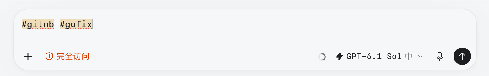
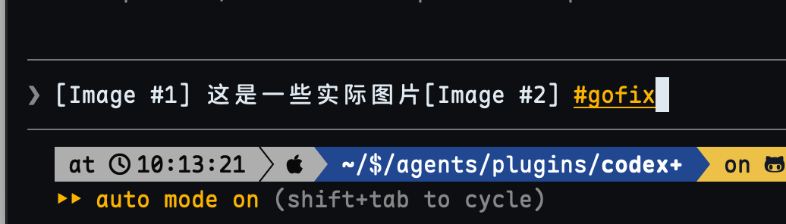
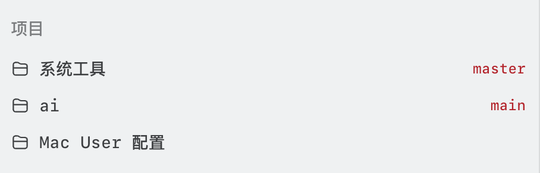

# codex+

为 macOS 版 Codex Desktop 提供本地界面增强：模型快捷键、发送前指令与 `#` 缩写、待回答提醒、消息头像、侧栏 Git 分支，以及闲置对话回收。

codex+ 通过本机回环的 Chrome DevTools Protocol（CDP）把脚本注入官方应用页面，**不修改官方应用包或可执行文件，不删除会话，也不上传任何数据**。停止 codex+ 或从官方入口启动 Codex，即可回到原版界面。

> [!NOTE]
> 本项目是非官方的个人工具，与 OpenAI 无关。它依赖 Codex Desktop 的内部页面结构，官方版本更新后部分功能可能暂时失效。

## 功能

- **模型快捷键**：`Ctrl+=` / `Ctrl+-` 在三个模型间循环切换，保留思考强度、草稿与焦点，不发送内容。
- **发送前指令**：在消息开头写 `#h`、`#sol-x` 等前缀，发送前自动切换模型与思考强度，并从正文中移除前缀。
- **`#` 缩写**：在 TOML 文件中定义缩写（支持参数与递归引用），发送前展开，输入框中实时高亮。同一份规则也可以在 Claude Code 中使用。
- **待回答提醒**：当前对话有未回答的原生提问时，输入框上方持续显示“待你回答”和问题摘要，点击即可打开原生回答面板。
- **消息头像**：为 GPT 回复和用户消息显示圆形头像，点击即可上传并裁剪自定义图片，图片只保存在本机。
- **侧栏 Git 分支**：在侧栏项目名称旁显示当前分支，按 `git status` 的惯例用颜色区分已暂存、未暂存与干净状态。
- **闲置对话回收**：`codex+ gc` 调用 Codex 官方的闲置对话回收器，提前释放闲置对话占用的 MCP 等后台进程；再次打开对话时会正常恢复。

## 环境要求

- macOS
- Codex Desktop（默认路径 `/Applications/ChatGPT.app`）
- Node.js 24 或更高版本
- 可选：[Claude Code](https://code.claude.com)，用于在 Claude Code 中使用 `#` 缩写

## 安装

```bash
git clone https://github.com/hjnayp/codex-plus.git
cd codex-plus
npm ci
node src/hosts/codex-desktop/main.ts update
```

`update` 会把源码打包成单文件产物 `bin/codex+.mjs`，把 `codex+` 命令链接到 `~/.local/bin`，并把手册安装到 `~/.local/share/man/man1`。首次运行时还会从 `hash-rules.example.toml` 生成你自己的规则文件 `hash-rules.toml`，之后不会覆盖它。请确认 `~/.local/bin` 已加入 `PATH`，也可以用 `CODEX_PLUS_INSTALL_PREFIX` 指定其他安装前缀。

打包产物不依赖 `node_modules` 或源码目录。之后修改源码或拉取新版本时，重新执行一次 `codex+ update` 即可生效。

## 快速开始

```bash
codex+ restart   # 退出 Codex，再以增强模式启动
codex+ status    # 查看守护进程、Codex 与已加载对话的状态
```

如果 Codex 尚未运行，用 `codex+ start` 或 `codex+ launch` 启动即可。从 Dock 或 Launchpad 等官方入口启动的 Codex 不会加载增强，`codex+ status` 会提示注入未启用。

## 使用

### 命令

| 命令 | 说明 |
| --- | --- |
| `codex+ start` | 启动守护进程并以增强模式打开 Codex；Codex 已以普通模式运行时会提示改用 `restart` |
| `codex+ launch` | 适合作为日常启动入口：增强模式已运行时只激活窗口，普通模式运行时自动切换 |
| `codex+ restart` | 退出 Codex，再以增强模式启动 |
| `codex+ stop` | 停止守护进程并移除全部界面增强，不退出 Codex |
| `codex+ status` | 显示守护进程、Codex、CDP 状态，以及本机已加载的全部对话 |
| `codex+ gc [-t <分钟>] [--dry-run]` | 回收闲置满指定分钟（默认 60）的对话；`--dry-run` 只列出、不回收 |
| `codex+ reload` | 重新加载 `#` 缩写规则，无需重启 Codex |
| `codex+ update` | 重新打包并安装命令、手册与 Claude Code 插件 |
| `codex+ --man` | 查看完整手册 |

### 模型快捷键

| 快捷键 | 效果 |
| --- | --- |
| `Ctrl+=` | 提升模型：6 Luna → 6.1 Sol → 6 Astra → 6 Luna |
| `Ctrl+-` | 降低模型：6 Astra → 6.1 Sol → 6 Luna → 6 Astra |

codex+ 只监听这两个组合键，其他快捷键原样交给 Codex。它不会禁用或改写 Codex 的原生快捷键。

### 发送前指令

在消息首段开头写指令，发送时 codex+ 会先切换模型与思考强度，确认生效后再删去指令、发送正文。之后的消息沿用这次选择的设置。

| 指令 | 效果 | 示例 |
| --- | --- | --- |
| `#l` `#m` `#h` `#x` | 切换思考强度为 low / medium / high / xhigh，模型不变 | `#h 排查这个问题` |
| `#astra` `#sol` `#luna` | 切换模型为 `gpt-6-astra` / `gpt-6.1-sol` / `gpt-6-luna`，强度不变 | `#sol 解释这个函数` |
| `#<模型>-<强度>` | 同时切换模型与强度 | `#sol-h 审查并发逻辑` |

指令可以连续组合，例如 `#sol #m 正文`，同一项重复指定时以后面的为准。

- 只识别首段开头、小写、与正文以空格分隔的独立指令；正文中的 `#h`、代码块和标题保持原样。
- 切换失败时消息不会发送，草稿保持原样，同时显示提示。
- 未知模型名会当作普通正文发送。

### `#` 缩写



在 `hash-rules.toml` 中定义缩写（首次 `update` 时从 `hash-rules.example.toml` 生成，不纳入版本库）：

```toml
[[rules]]
trigger = "#gitrb"
text = "将当前分支 rebase 到远端主分支上，审慎处理冲突。"
```

输入和粘贴时保留原文，发送或加入队列前才展开。输入框中会生效的缩写会实时高亮，代码块、行内代码和未定义的 token 保持原样。修改规则后执行 `codex+ reload` 即可生效。

缩写支持参数，在 `trigger` 中按顺序声明默认值，在 `text` 中用 `{参数名}` 引用：

```toml
[[rules]]
trigger = "#review(ai=claude, model=opus)"
text = "将改动提交给 {ai} 审查，使用 {model}。"
```

| 写法 | 展开结果 |
| --- | --- |
| `#review` | 将改动提交给 claude 审查，使用 opus。 |
| `#review(model=fable)` | 将改动提交给 claude 审查，使用 fable。 |
| `#review(codex, sol)` | 将改动提交给 codex 审查，使用 sol。 |

- 位置参数必须写在具名参数之前；参数值可以用引号包围，例如 `#review("Codex, local", sol)`。
- `text` 中可以引用其他缩写，包括带参数的调用，展开时会递归处理。
- 规则文件存在语法错误、重复的 trigger、循环引用或展开过长时，`reload` 会报告失败，旧规则继续生效。
- 调用写错（未知参数、参数过多、括号未闭合）时，这一整段保留原文且不高亮。

用环境变量 `CODEX_PLUS_HASH_RULES_FILE` 可以改用其他位置的规则文件。

### 在 Claude Code 中使用 `#` 缩写



`claude/` 目录是一个 Claude Code 插件，与 Codex 共用同一份 `hash-rules.toml` 和解析逻辑。先执行一次 `codex+ update` 生成 hook 文件，再安装插件：

```bash
claude plugin marketplace add /path/to/codex-plus
claude plugin install hash-rules@codex-plus
```

插件会在提示发送前展开缩写，并在输入框中高亮。规则修改后自动生效，无需重新安装。展开失败时提示不会发送，原文会放回输入框。Codex 的模型与强度指令不适用于 Claude Code。

### 侧栏 Git 分支



侧栏中的 Git 项目会在名称旁显示当前分支，worktree 和多仓库各自查询。分支名只显示最后一个 `/` 之后的部分，例如 `feat/1012/登录优化` 显示为 `登录优化`。颜色沿用 `git status` 的含义：只有已暂存改动或仓库干净时为绿色，有未暂存或未跟踪文件时为红色，读取失败时为灰色。可见页面每 5 秒刷新一次，窗口重新聚焦时立即刷新；codex+ 只读取 Git 状态，不执行任何写操作。

### 回收闲置对话

Codex 为每个已加载的对话保留 MCP 服务器等后台进程，官方默认在闲置 3 小时后才回收。`codex+ gc` 沿用官方回收器和保护规则，只把阈值改为可配置：

```bash
codex+ gc --dry-run   # 列出闲置满 60 分钟、将被回收的对话
codex+ gc             # 执行回收
codex+ gc -t 30       # 本次改用 30 分钟阈值
```

正在查看、进行中、等待审批或输入，以及仍有后台终端的对话都不会被回收。被回收的对话在下次打开时正常恢复。守护进程运行期间，每 30 分钟会自动执行一次 `gc -t 30`，结果写入日志。

## 配置

codex+ 通过环境变量配置，均为可选：

| 变量 | 默认值 | 说明 |
| --- | --- | --- |
| `CODEX_PLUS_INSTALL_PREFIX` | `~/.local` | `update` 安装命令与手册的前缀 |
| `CODEX_PLUS_HASH_RULES_FILE` | 仓库内的 `hash-rules.toml` | `#` 缩写规则文件 |
| `CODEX_PLUS_CDP_PORT` | `57331` | 本机 CDP 端口；默认端口被占用时自动选择并记住一个可用端口 |
| `CODEX_PLUS_CHATGPT_APP` | `/Applications/ChatGPT.app` | Codex Desktop 应用路径 |
| `CODEX_PLUS_STATE_DIR` | `~/.codex/codex+` | 状态文件与日志目录 |
| `CODEX_PLUS_STARTUP_TIMEOUT_MS` | `90000` | 冷启动等待时间 |
| `CODEX_PLUS_STOP_TIMEOUT_MS` | `7000` | 优雅停止守护进程的等待时间 |
| `CODEX_PLUS_FORCE_STOP_TIMEOUT_MS` | `2000` | 超时后强制停止的等待时间 |

## 停用与卸载

```bash
codex+ stop   # 移除界面增强，Codex 继续运行
```

之后从官方入口启动的 Codex 即为原版。如需完全卸载，再删除以下文件：

```bash
rm ~/.local/bin/codex+ ~/.local/share/man/man1/codex+.1
rm -r ~/.codex/codex+                       # 状态与日志
claude plugin uninstall hash-rules@codex-plus   # 如果安装过 Claude Code 插件
```

自定义头像保存在 Codex 应用的本机存储中，停用后保留，重新启用时继续使用。

## 工作原理

- codex+ 以本机回环 CDP 端口启动官方 Codex，守护进程把界面脚本注入每个 Codex 页面，之后新加载的页面也会自动注入。
- 模型与强度切换通过 Codex 原生的模型菜单完成，不读取或改写 Codex 的模型配置，也不接管 `openai_base_url`。
- 停止时会调用每项增强的清理入口，移除注入的节点、样式与事件监听。
- 头像、规则和状态都只保存在本机。

## 开发

```bash
npm test            # 运行测试；部分界面测试需要本机安装 Google Chrome
npm run typecheck   # TypeScript 类型检查
claude plugin validate claude
codex+ --self-test  # 检查已打包产物是否包含全部界面能力
```

源码为 TypeScript，Node 直接运行 `.ts`，esbuild 负责打包。代码结构、设计约定与各模块说明见 [docs/DEVELOPMENT.md](docs/DEVELOPMENT.md)。

## 许可证

[MIT](LICENSE)
